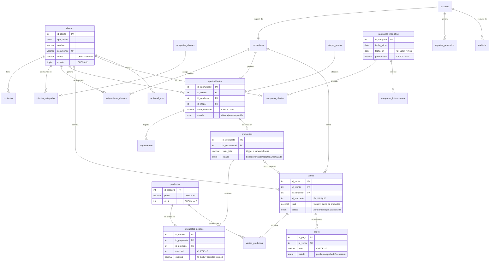
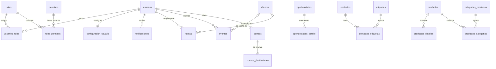

# Modelo de datos (DMR) y justificación

Entregable de la **Sesión 1**. El diagrama se dibuja con Mermaid: GitHub y VS Code (extensión *Markdown Preview Mermaid Support*) lo muestran directamente. Para exportarlo como imagen se puede pegar en <https://mermaid.live>. MySQL Workbench también puede generarlo desde la base cargada: *Database → Reverse Engineer*.

## 1. Núcleo comercial (clientes, propuestas, ventas, marketing, reportes)

## 2. Seguridad, seguimiento y soporte

`info_companie` es una tabla de configuración independiente (una fila: la empresa dueña del sistema).

## 3. Justificación del diseño

**Normalización (3FN).** Cada hecho se guarda una sola vez. El vendedor actual de un cliente no se copia en `clientes`: se obtiene de la última fila de `asignaciones_clientes` (vista `vw_cliente_vendedor_actual`), lo que además conserva el historial de reasignaciones. Las relaciones muchos-a-muchos (cliente–categoría, producto–categoría, contacto–etiqueta, campaña–cliente, usuario–rol, rol–permiso) usan tablas puente con llave primaria compuesta, que impide duplicados.

**Separación propuesta / venta.** Una oportunidad puede tener varias propuestas (versiones), pero cada propuesta genera como máximo una venta (`UNIQUE (id_propuesta)` en `ventas`). Las ventas directas, sin propuesta, también son válidas (`id_propuesta` admite NULL). Los detalles guardan `precio_unitario` porque el precio del catálogo cambia con el tiempo y la venta debe conservar el precio pactado.

**Valores derivados controlados.** `propuestas.valor_total` y `ventas.total` se podrían calcular siempre con `SUM`, pero se guardan por rendimiento en listados y reportes. Para que nunca se desincronicen, solo los escriben los triggers de las líneas, y una restricción `CHECK (subtotal = cantidad * precio_unitario)` asegura cada línea.

**Políticas de borrado.**
- `ON DELETE CASCADE` en filas que no existen sin su padre: detalles de propuestas y ventas, contactos, tablas puente y destinatarios de correo.
- `ON DELETE SET NULL` en historial que debe sobrevivir: la auditoría y la actividad web cuando se borra un usuario, y los eventos cuando se borra un cliente.
- `RESTRICT` (por defecto) en los datos comerciales: no se puede borrar un cliente con ventas ni una venta con pagos. La aplicación **desactiva** (`estado = 0`) en lugar de borrar.

**Restricciones de dominio.** `ENUM` para los estados (no se admiten valores fuera del ciclo de vida) y `CHECK` para montos no negativos, cantidades positivas, rangos de fechas válidos, formato básico de correo y banderas 0/1.

**Estados como máquina de estados.** Las transiciones válidas (por ejemplo, una propuesta aceptada no vuelve a borrador; un pago aprobado no cambia) se hacen cumplir en la base de datos con triggers `BEFORE UPDATE`, no solo en la interfaz, para que ninguna aplicación cliente pueda saltárselas.

**Tipos de datos.** `DECIMAL(12,2)` para dinero (sin errores de redondeo de coma flotante), `utf8mb4` para nombres con tildes y eñes, `TIMESTAMP` para fechas de registro y `DATE` para fechas de negocio.
